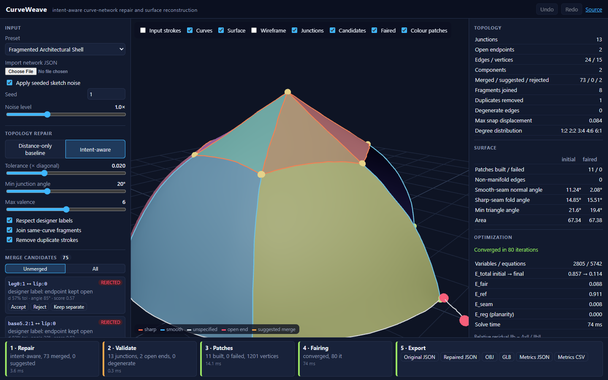

# CurveWeave

**Intent-aware repair of architectural 3D curve networks, with feature-preserving patch reconstruction.**

CurveWeave turns imperfect 3D curve networks into welded surface meshes while keeping the designer's intent. Such networks come from quick architectural sketches or VR drawings, where endpoints almost meet, edges arrive in fragments and strokes are drawn twice. Folds stay sharp, smooth seams stay smooth, and ends meant to stay free are not snapped. Every repair decision is explained and can be overridden or undone.

**Live demo:** https://romanjahandideh.github.io/curveweave/ · **Author:** [Roman Jahandideh](https://romanjahandideh.com)



## What it does

1. **Repairs topology.** Candidate endpoint merges get an interpretable score from distance and outgoing-tangent angle. Designer labels (*keep open*, *keep separate*) are hard constraints, and complete-linkage and no-collapse checks prevent wrong junctions. Ambiguous merges become **suggestions** for the designer instead of silent decisions. Fragments are joined and duplicate strokes removed. A distance-only baseline is included for comparison.
2. **Reconstructs patches.** Labelled 4-sided loops become Coons patches and 3-sided loops get a harmonic fill. Patches are welded along shared curves. Sharp seams keep split render normals and a measured fold angle.
3. **Fairs the surface with a real solver.** It minimizes $E = \lambda_{fair}E_{fair} + \lambda_{ref}E_{ref} + \lambda_{seam}E_{seam} + \lambda_{reg}E_{reg}$, a sparse least-squares problem solved with preconditioned conjugate gradients. Residual and energy histories come from the actual iterates, and the solver reports **not converged** when it hasn't converged. Planarity is the optional architectural regularity.
4. **Previews fabrication.** It flattens a patch, reports edge and area distortion and inverted triangles, and exports SVG.
5. **Exports** the original and repaired network JSON, OBJ, GLB, metrics as JSON and CSV, and SVG.

Three original procedural presets are included: **Folded Pavilion**, **Curved Landscape Canopy** and **Fragmented Architectural Shell**. You can also import your own network JSON (format: [`src/geometry/types.ts`](src/geometry/types.ts)).

## Results in brief

In 360 seeded benchmark runs ([docs/RESULTS.md](docs/RESULTS.md)):

- **Precision:** with designer labels, junction precision is 0.998, against 0.965 for distance-only snapping.
- **Patch success:** it rises from 0.74 to 0.92. The diagnostics attribute that gain to fragment and duplicate handling.
- **Where it falls short:** tangent scoring alone did not reduce false merges. At the highest noise level the method is more conservative and loses recall.

The data is synthetic; see [docs/LIMITATIONS.md](docs/LIMITATIONS.md).

## Run it

Requires Node 20 or later.

```bash
npm install
npm run dev          # http://localhost:5173/curveweave/
npm test             # unit tests (Vitest)
npm run test:e2e     # browser tests (Playwright; first run: npx playwright install chromium)
npm run benchmark    # regenerates results/ (CSV, JSON, tables, SVG charts)
npm run build        # typecheck + production build to dist/
```

Everything runs client-side. There is no backend, API key or paid service. Pushes to `main` are built, tested and deployed to GitHub Pages by [`.github/workflows/deploy.yml`](.github/workflows/deploy.yml).

## Documentation

| Document | Contents |
|---|---|
| [RESEARCH_SUMMARY.md](docs/RESEARCH_SUMMARY.md) | About 500-word overview |
| [LITERATURE_REVIEW.md](docs/LITERATURE_REVIEW.md) | Verified citations and what was taken from each |
| [RESEARCH_POSITIONING.md](docs/RESEARCH_POSITIONING.md) | Gap, comparison and hypothesis |
| [MATHEMATICAL_MODEL.md](docs/MATHEMATICAL_MODEL.md) | Repair rules, patches, energy, solver, flattening |
| [EXPERIMENTS.md](docs/EXPERIMENTS.md) | Benchmark protocol and threats to validity |
| [RESULTS.md](docs/RESULTS.md) | Measured results: what is and is not supported |
| [LIMITATIONS.md](docs/LIMITATIONS.md) | Known limitations |
| [DEMO_SCRIPT.md](docs/DEMO_SCRIPT.md) | Five-minute walkthrough |
| [PLAN.md](docs/PLAN.md) | Architecture and risk assessment |

## Code map

```
src/geometry/  pure TypeScript geometry, no UI: repair, validate, patches, sparse, solver,
               mesh, flatten, noise, presets, evaluate, pipeline, io
src/app/       React + React Three Fiber interface
scripts/       benchmark and diagnostics
tests/  e2e/   Vitest unit tests and Playwright browser tests
results/       benchmark outputs
```

## Status and attribution

CurveWeave is an independent research prototype: an engineering study, not a published or peer-reviewed algorithm. It builds on established techniques (spatial hashing, union–find, Coons patches, Laplacian fairing, conjugate gradients), and its design is informed by the literature cited in [LITERATURE_REVIEW.md](docs/LITERATURE_REVIEW.md). No code, figures or data from those works are used. The project is not affiliated with, supervised by or endorsed by the cited authors or their institutions. It is not compared with, and makes no claim to improve on, published reconstruction systems such as SharpEdge.

MIT licence. See [LICENSE](LICENSE).
