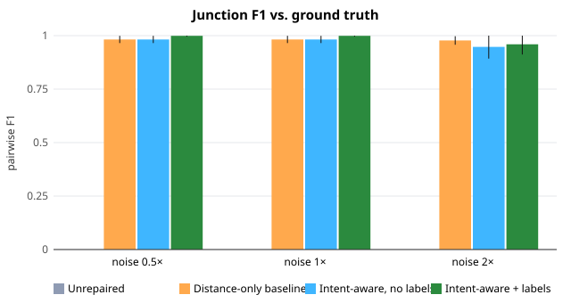
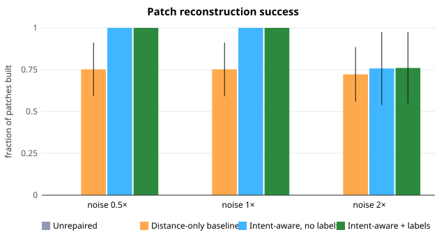
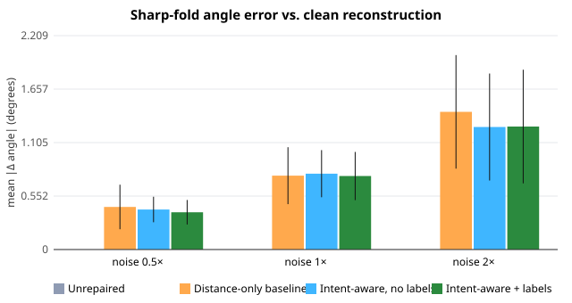
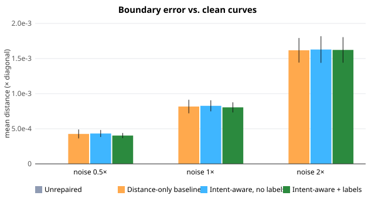
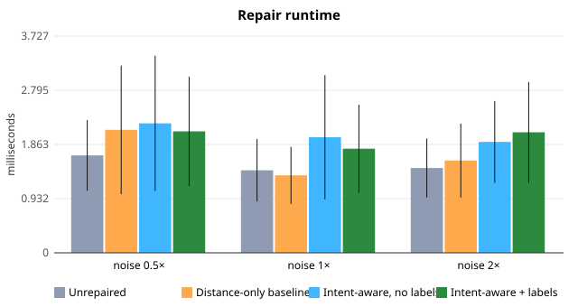

# Results

All numbers come from `npm run benchmark` at commit `13b08ea`: 360 runs under the protocol in [EXPERIMENTS.md](EXPERIMENTS.md). The complete generated tables are in [`results/tables.md`](../results/tables.md), per-run rows in [`results/benchmark.csv`](../results/benchmark.csv), and aggregates in [`results/summary.json`](../results/summary.json). Values are mean ± sample standard deviation over presets, noise levels and seeds unless stated otherwise. The benchmark is deterministic; re-running it reproduces every value except the runtimes.

## Overall

| Method | Junction precision | Junction recall | Junction F1 | Patch success | Non-manifold edges | Repair time (ms) |
|---|---|---|---|---|---|---|
| Unrepaired | 1.000 ± 0.000 | 0.000 ± 0.000 | 0.000 ± 0.000 | 0.000 ± 0.000 | 0 | 1.5 ± 0.6 |
| Distance-only baseline | 0.965 ± 0.032 | 0.997 ± 0.013 | 0.981 ± 0.018 | 0.742 ± 0.160 | 0 | 1.7 ± 0.8 |
| Intent-aware, no labels | 0.968 ± 0.033 | 0.976 ± 0.059 | 0.971 ± 0.038 | 0.919 ± 0.169 | 0 | 2.0 ± 1.0 |
| Intent-aware + labels | 0.998 ± 0.007 | 0.976 ± 0.059 | 0.986 ± 0.033 | 0.920 ± 0.167 | 0 | 2.0 ± 0.9 |

The fairing solver converged (relative residual ≤ 1e-8) in 100% of runs that produced at least one patch, for every method.

## By noise level

| Method | F1 0.5× | F1 1× | F1 2× | Patch success 0.5× | Patch success 1× | Patch success 2× |
|---|---|---|---|---|---|---|
| Distance-only baseline | 0.982 ± 0.017 | 0.982 ± 0.017 | 0.977 ± 0.020 | 0.752 ± 0.161 | 0.752 ± 0.161 | 0.722 ± 0.163 |
| Intent-aware, no labels | 0.982 ± 0.017 | 0.982 ± 0.017 | 0.948 ± 0.055 | 1.000 ± 0.000 | 1.000 ± 0.000 | 0.758 ± 0.218 |
| Intent-aware + labels | 0.999 ± 0.003 | 0.999 ± 0.003 | 0.960 ± 0.048 | 1.000 ± 0.000 | 1.000 ± 0.000 | 0.761 ± 0.214 |

The 0.5× and 1× results are identical. The noise level scales the same random draws, and at both levels every endpoint error stays well inside the tolerance, so every discrete merge decision is the same.

## What the evidence supports

1. **Some repair is necessary.** With no repair, no patch can be built (patch success 0) because noisy endpoints never coincide.
2. **The designer labels remove the false merges.** Precision rises from 0.965 (baseline) and 0.968 (intent-aware without labels) to 0.998 with labels. The other two methods' false merges are mostly the labelled free ends (the rain spout and the canopy lip), which lie within tolerance of a corner. Over all 90 perturbed networks (`npm run diagnose`), these ends account for 138 of the baseline's 150 false-positive endpoint pairs and 124 of 136 for intent-aware repair without labels. With labels, 12 false-positive pairs remain, none involving a labelled end. Without labels, the tangent and valence evidence did **not** separate them: precision without labels is essentially the baseline's.
3. **The patch-success gain comes from fragment and duplicate handling, not from junction accuracy.** The baseline's junction F1 is high (0.981), yet it builds only 74% of patches. `npm run diagnose` attributes its patch failures (20 at 1×, 21 at 2× on seeds 1–3) to curves whose fragments do not form one chain. These are branches created by duplicate strokes, which the baseline never removes. The intent-aware method removes duplicates and joins fragments, and builds every patch at 0.5× and 1×.
4. **At 2× noise the intent-aware method is more conservative and loses recall.** Its recall falls and its F1 at 2× (0.948 without labels, 0.960 with) drops below the baseline's (0.977). The diagnostic shows why: candidates near the tolerance become *suggestions*, and the complete-linkage check refuses merges that would chain endpoints farther apart than the tolerance. Both are deferred to the designer, but no user decisions are simulated in the benchmark, so they count as misses. Patch success at 2× is about 0.76 for all three repairing methods.

## What the evidence does not support

- **That tangent-aware scoring improves precision at matched recall.** On this benchmark, intent-aware repair without labels has about the baseline's precision and lower recall. The hypothesis in [RESEARCH_POSITIONING.md](RESEARCH_POSITIONING.md) is supported only in the narrower form "explicit labels plus fragment and duplicate handling".
- **Surface-quality differences.** Fold-angle error (baseline 0.87 ± 0.57°, intent-aware 0.81 ± 0.49° without labels and 0.80 ± 0.51° with) and smooth-seam angle (2.56° versus 2.62°) differ by much less than their spread. They are also averaged over different subsets of patches, so no ranking is claimed. Boundary error is about 0.001 × diagonal for every repairing method.
- **Generality.** Three synthetic networks, produced by a generator written alongside the method, cannot establish performance on real sketches (see [LIMITATIONS.md](LIMITATIONS.md)).

## Solver behaviour

On the clean presets at resolution 12, CG converges in 48 (Folded Pavilion), 73 (Curved Landscape Canopy) and 79 (Fragmented Architectural Shell) iterations, on systems of 1,815 to 2,805 unknowns, in under 80 ms each in Node. Fairing reduces the mean smooth-seam normal angle from 7.06° to 2.34° (canopy) and from 9.25° to 1.89° (shell), and changes the sharp fold angles by less than 1° (pavilion 67.61° → 67.15°). These single-run values come from the development probe in Phase 3; the in-app metrics panel reproduces them for any configuration. The unit tests check monotone energy decrease, fixed boundaries and honest non-convergence when the iteration budget is too small.

